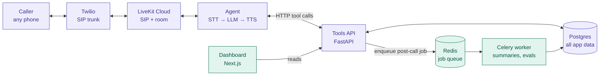

# Design

See `requirements.md` for the full analysis (all tiers). Record decisions here before writing code.

## Architecture



Purple = MVP, teal = added in V1.

### During a call

1. The caller dials the Twilio number; Twilio forwards the call over the Elastic SIP trunk.
2. LiveKit Cloud's inbound trunk accepts it, and the dispatch rule creates a room and adds the caller as a SIP participant.
3. LiveKit dispatches the agent into the room. The agent connects *out* to LiveKit Cloud, so it can run on a laptop with no public URL.
4. When the LLM needs data it calls a tool, which is a thin HTTP call to the tools API. Only the API touches Postgres, so booking rules (unique slot index, idempotency) live in one place and can be tested without voice.

### One turn inside the agent

```
Caller audio ──► Silero VAD ──► Deepgram STT (streaming)
                      │                    │
                      └──► Turn detector: "finished?" ── yes ──► Gemini LLM
                                                                   │
                                          (optional tool call → API → back to LLM)
                                                                   ▼
Caller hears ◄── LiveKit room ◄── Deepgram TTS ◄──── first sentence of reply
```

- **Silero VAD** detects whether there is speech in the audio right now. It also triggers interruptions when the caller talks over the agent.
- **LiveKit turn detector** reads the transcript so far and decides whether the caller has finished, so a mid-sentence pause ("my date of birth is… um… March third") doesn't end the turn.
- Per-turn metrics stored in `call_turns`: `e2e_latency_ms` (caller stops → agent audio starts), `llm_ttft_ms` (time to first LLM token), `tts_ttfb_ms` (time to first TTS audio). Turns with a tool call are slower: one API round trip plus a second LLM call.

### After the call (V1)

1. The agent tells the API the call ended.
2. The API enqueues a post-call job on Redis.
3. The Celery worker reads the transcript, generates a summary (and eval results) with the LLM, and writes them to Postgres. If the worker dies, the job stays queued and is retried with backoff.
4. The dashboard reads calls, transcripts, latency and eval scores through the API.

### Where things run during development

| Piece | Where |
|-------|-------|
| Agent | Laptop; LiveKit console mode (local mic/speakers) until the telephony step |
| Tools API, Postgres (Redis in V1) | Docker Compose on the laptop; agent calls the API on `localhost` |
| LiveKit, Twilio, Deepgram, Gemini | Their cloud services, free tiers |

## Decisions

Status: **decided** = chosen; **proposed** = suggested, not yet confirmed; **open** = still to decide.

| Decision | Choice | Status |
|----------|--------|--------|
| Target | End product (MVP → V1 → Stretch), built tier by tier | decided |
| Cost approach | Free tiers only until the public demo; pay only for the demo month | decided |
| STT | Deepgram (`livekit-agents[deepgram]`) | decided |
| LLM | Google Gemini Flash-Lite via `livekit-agents[google]`, free tier from Google AI Studio (`GOOGLE_API_KEY`). Pick the exact model ID from AI Studio's free-tier list. | decided |
| TTS | Deepgram Aura (same provider and key as STT) | proposed |
| VAD / turn detection | Silero VAD + LiveKit turn detector | decided |
| Hosting – agent | LiveKit Cloud, free Build plan | proposed |
| Hosting – API, Postgres, Redis, worker | Docker Compose on the local machine for MVP; revisit for V1 deploy | proposed |
| Hosting – dashboard | Open (V1) | open |
| Development without a phone | LiveKit console mode (local microphone/speakers) until telephony step | proposed |
| Phone number | Twilio trial with verified numbers during development; upgrade for the public demo. Country open. | proposed |
| Clinic setup | 2 doctors, 30-minute slots (spec suggestion); opening hours and time zone open | open |
| Languages | English for MVP; Urdu/Arabic only if picked as Stretch | open |
| Monthly budget cap | $0 during development; demo-month cap open | open |
| Identification fallback / handoff target | `take_message` for MVP; V1 handoff target open | open |
| Stretch items (pick 1–2) | – | open |

## Free-tier plan and limits

Figures are as reported in Oct–Nov 2026; verify in each provider's console before relying on them.

| Service | Free allowance | Limit that matters |
|---------|----------------|--------------------|
| Gemini Flash-Lite | ~10 requests/min, ~500 requests/day per project | A booking call uses ~15–20 LLM requests (each turn + each tool call), so ~25 test calls/day. Flash is ~20 requests/day (about one call), so don't use it on the free tier. Free-tier prompts may be used by Google; fine because all data is fake. |
| Deepgram | $200 sign-up credit | Covers STT + TTS for development. Expiry terms unclear. |
| LiveKit Cloud (Build) | 1,000 agent session minutes/month, 5 concurrent sessions | Hard cap, no overage. |
| Twilio trial | Trial credit | Inbound calls only from up to 5 verified numbers, so strangers cannot call. Must upgrade for the public demo. |

Consequences:

- Rate-limit (429) errors from Gemini can happen mid-call on the free tier. The V1 "tools API times out" handling (retry once, then offer a callback) should also cover LLM errors.
- V1 LLM-judge evals in CI share the same daily Gemini quota. Run them only on `main` or cap the number of cases, or use a paid key for CI.
- Before the public demo: paid Gemini key, upgraded Twilio account. Set the demo-month budget cap then.

## Trade-offs

- **Pipeline vs realtime model:** a modular STT → LLM → TTS pipeline instead of a speech-to-speech realtime model. It exposes per-stage latency (`llm_ttft_ms`, `tts_ttfb_ms`), lets each provider be swapped independently, and matches the project's goal of showing real-time voice pipeline skills. Cost: more moving parts and usually higher end-to-end latency than a realtime model.
- **Idempotency keys:** a retried request (tools API timeout, network blip) must not create a second booking or cancel twice. Keys are stored in an `idempotency_keys` table with the original response, so book, cancel and reschedule all use one mechanism. Keys are generated in agent code (deterministic from call ID + operation + target), never by the LLM, so a retry reuses the same key. The partial unique index on `appointments(slot_id) WHERE status = 'booked'` separately guarantees no double-booking between two different callers.
